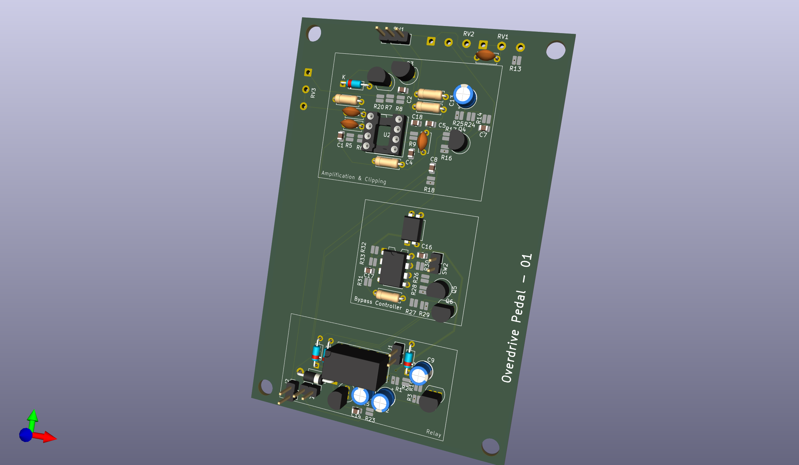

# Chopp-E
## MOSFET-Clipping Overdrive Guitar Pedal, derived from the Fulltone OCD
Chopp-E is a custom guitar overdrive designed for a friend. The process began with the well-known OCD circuit as a starting point; each stage was then analyzed by hand and verified in LTspice, and the problems encountered along the way were remedied. The mechanical footswitch was replaced by a microcontroller-controlled relay bypass.

## Attribution
The core audio circuit is deribed from the Fulltone OCD, as traced by PCBGuitarMania. The analysis, modifications, bypass, controller, schematic capture, simulation, PCB layout, and firmware are my own work. This is a one off build with no intention to be used as a commercial product.
## Hear it!
Simulated before and after renders are in [/audio](/audio).
## Specifications
| Spec | Value |
| ---- | ----- |
| Controls| Drive (A1M), Tone (B10K), Volume (A100K), Hi/Low toggle |
| Bypass| Relay true bypass, soft touch footswitch, output muting during switching |
| Clipping| Asymmetric MOSFET clipping (2N7000 / body diode) |
| Gain| 17.4 dB to 45.5dB, input to clipper |
| Power| 9 V DC, ~7.4mA |
| PCB| two layer, solid ground plane, SMD fixed parts, socketed tone shaping parts |
## Signal Path
Input buffer -> Gain stage -> MOSFET clipper -> Recovery stage -> Tone / Hi-low / Volume -> Output buffer
## Changes from reference
1. Input buffer. Removed JFET's drain resistor, ensuring it remains saturated across the full $I_{DSS}$ range listed on the datasheet
2. Output buffer. Converted the collector output stage to an emtiier follower, tripling headroom (0.9$\pm$V to 2.6$\pm$) and cutting output impedance from 10k $\Omega$ to 230 $\Omega$
3. Relay bypass. An ATtiny85 drives a latching relay and mutes the output while switching.
## Key Results
| Subject | Hand analysis results | LTspice |
| -------- | --------------------- | ------- |
| Input buffer bias | 1.55V, 0.155 mA | 1.549V, 0.155 mA|
| Gain-stage peak, max Drive | 45.4dB | 45.5 dB|
| Treble shelf, Hi / Tone up | -10.2 dB | -10.3 dB |
| 1 dB compression, Max Drive | 3.5 mV pk | 3.4 mV pk |
| Negative clipping level | -0.6V (body diode) | -0.62V |
| Output THD, 0.3 V input at 1kHz | -| 35% |
## Hardware
Two layer PCB with a solid ground plane, laid out in 3 zones. The relay (switching and power input), bypass controller, and audio path (input buffer, gain stage, clipper, recovery, tone) were kept separate to keep digital and relay noise away from high-gain input. Fixed parts are SMD for fab assembly, the tone shaping parts sit in through-hole sockets so they can be swapped.
- KiCad schematic, PCB, and gerbers: [/hardware](hardware/).
- Through-hole parts list and assembly notes: [BOM](docs/bom.md).
## Firmware
The ATtiny85 bypass controller ([firmware/](firmware/), C++ with PlatformIO) handles:
- debounced footswitch input
- relay switching with the output muted before and after each coil pulse, for pop-free switching
- EEPROM state recall, so pedal powers up in its last state
- power down sleep between presses, woken by pin-change interrupt, so the MCU is electrically silent next to the audio path
## Status 
- [x] Hand analysis  
- [x] Schematic, ERC clean 
- [x] Simulation on LTspice 
- [x] PCB Layout, DRC clean 
- [x] Firmware: debounced input, muted relay switching, EEPROM state memory, interrupt driven sleep mode (validated in simulation) 
- [ ] Build & test
***
*Jubal Clapp | Electrical Engineering @ Queen's University | Fall 2026*